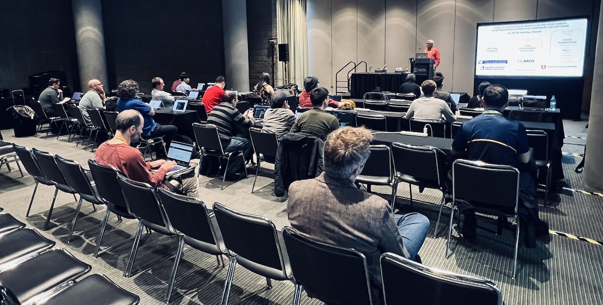

# Navigating Mixed-Precision: Tools and Techniques for Floating-Point Error Profiling

#### SC26, Chicago 

November 16, 2026 

Time: 1:30pm - 5:00pm CST (half-day tutorial) \

Location: McCormick Place, Chicago, Room: W184b-c 

<!--
## Click [here](#) to fill out survey.
-->

   

## Description

Floating-point arithmetic is the bedrock of scientific computing, 
yet it frequently introduces subtle errors and non-deterministic 
behavior in numerical software. As the HPC community shifts toward 
mixed-precision execution to unlock performance and energy-efficiency gains, 
developers require robust methodologies to rigorously analyze 
floating-point error accumulation. 

This tutorial provides a comprehensive introduction to two 
state-of-the-art tools designed 
to guide precision-tuning decisions in both CPU and GPU-accelerated 
applications. 
The first tool is [FPChecker](https://fpchecker.org/), which leverages the 
Clang/LLVM compiler infrastructure to perform static and dynamic analysis 
of C/C++ applications. The second is [NixNaN](https://github.com/parfloat/nixnan), 
a high-performance profiler built on the NVIDIA NVBit dynamic 
instrumentation framework, engineered to detect floating-point exceptional 
values arising during CUDA kernel execution without requiring 
source modification or recompilation. 

Throughout this session, participants will learn:

1. to assess the floating-point dynamic range of applications, 
2. visualize the propagation of rounding errors, and
3. isolate performance-critical numerical issues, such as overflows, and NaNs. 

The tutorial emphasizes a hands-on approach: attendees will engage with 
accessible examples (e.g., simple linear solvers) configured to run 
locally on their laptops. In the advanced session, 
we transition to real-world impact, where participants 
will apply these tools to larger numerical libraries (e.g., Hypre).

## Presenter

* [Ignacio Laguna](https://lagunaresearch.org/), Lawrence Livermore National Laboratory
* [Ganesh Gopalakrishnan](https://users.cs.utah.edu/~ganesh/), University of Utah
* [Mark S. Baranowski](https://soarlab.org/team/baranowski/), University of Utah

## AWS Instances

[https://fpchecker.org/usernames](https://fpchecker.org/usernames)

## Presentation Slides

* FPChecker [slides](slides/SC26-fpchecker_tutorial.pdf)
* NixNaN [slides](slides/SC26-Half-Day-Tutorial-Mixed-Precision-Insights-NixNan-Utah.pdf)

## Repositories:

* FPChecker: [https://github.com/LLNL/FPChecker](https://github.com/LLNL/FPChecker)
* [Documentation](https://fpchecker.org)
* NixNaN: [https://github.com/parfloat/nixnan](https://github.com/parfloat/nixnan)
